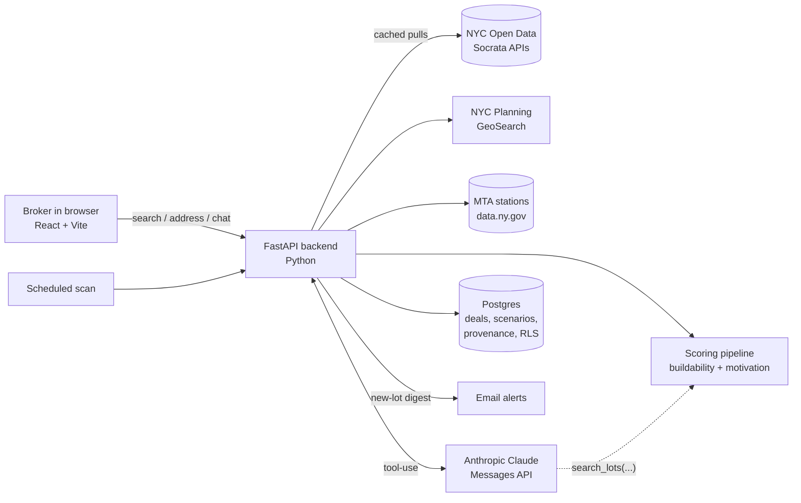
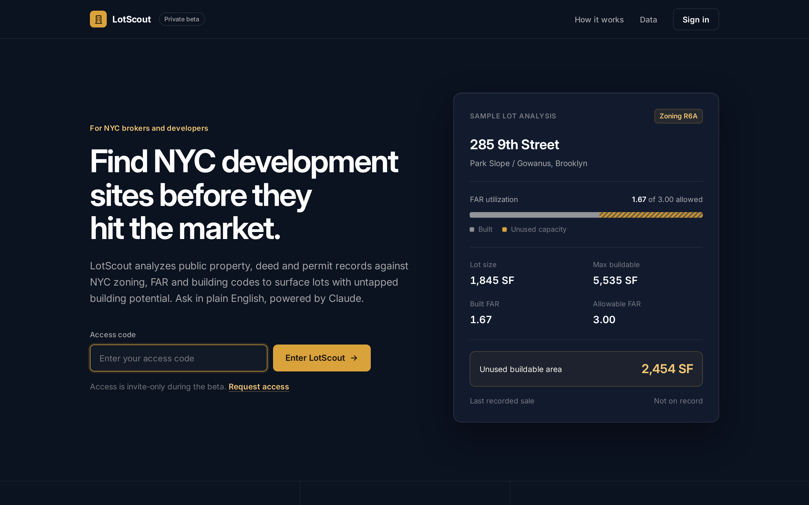
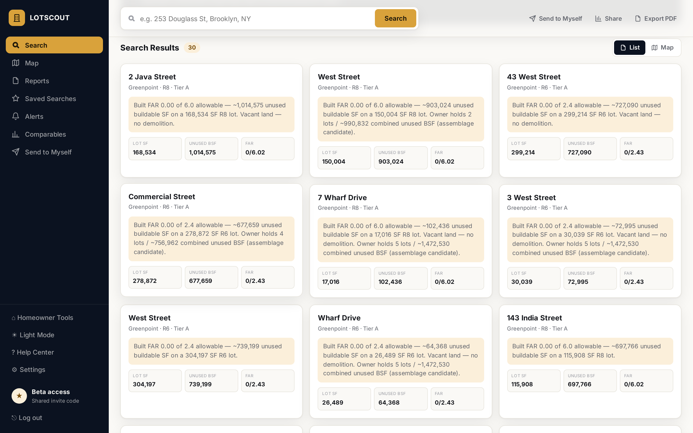
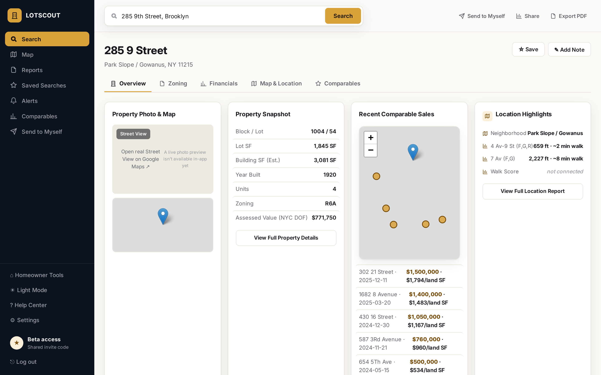
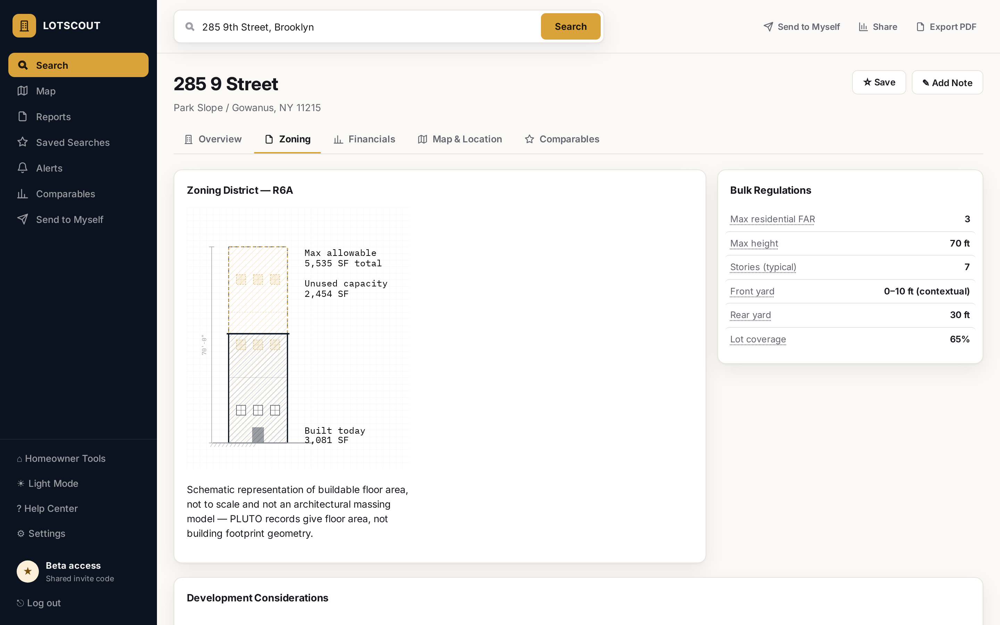
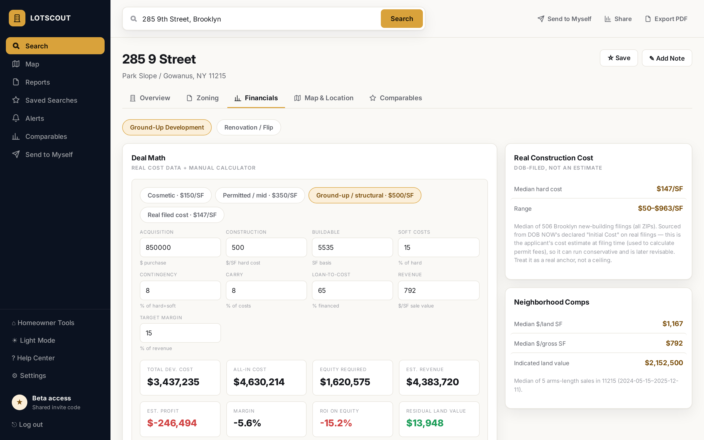

# LotScout

**Finds underbuilt NYC lots in public city data, scores them, and lets you search them in plain English.**

---

## The problem

In New York City, a development site is usually a lot that zoning allows to be much bigger than what's on it now. Most of the information needed to find these lots is public, but it's split across a dozen NYC Open Data datasets that don't share formats:

- **Zoning capacity** is in PLUTO (allowable FAR compared with built FAR).
- **Ownership and tenure** are in ACRIS deed records.
- **Whether someone is already building** is in DOB permit filings, which live in two separate systems (legacy BIS and DOB NOW) that encode boroughs, lot numbers and dates differently.
- **Signs that an owner may sell** are spread across DOB, ECB and HPD violations, housing-court cases and the tax-lien sale list.
- **Constraints** like landmark and historic-district status sit in a separate LPC dataset.

A land broker working through this by hand spends hours cross-referencing records for every lot. I built LotScout so that work happens in one search, and so every score can be traced back to the record behind it.

## What it does

- **Neighborhood and borough sweeps.** Scans curated Brooklyn neighborhoods, or any of the five boroughs, and ranks lots by unused buildable square footage.
- **Address lookup, citywide.** Enter any NYC address (with autocomplete) and get a full scored property card.
- **Buildability tiers.** Lots are sorted into A (Target), B (Track), C (Watch) and S (Starter), with a plain-English "why" sentence on each card.
- **Assemblage detection.** Flags lots where one owner holds several parcels on the same block. Neighboring underbuilt lots with different owners are also shown, labeled as the harder play they are.
- **Seller-motivation score (0–100).** Kept separate from buildability. It is built from estate/trust ownership, tax-lien listing, DOB/ECB/HPD violations, housing-court cases, out-of-state owners and long tenure. Every point is listed in the detail view.
- **False-positive filters.** Lots with a recent DOB New Building filing, lots PLUTO probably hasn't caught up on (built recently but still reading as underbuilt) and landmarked lots are pushed down the ranking and flagged, not quietly dropped.
- **Ask in plain English (prototype).** A natural-language search built on Anthropic's Claude tool-use (details below).
- **Deal math.** Zoning envelope diagram, development scenarios, recent comparable sales, median DOB-filed construction cost per SF, a residual-land-value calculator and a renovation/flip calculator.
- **Broker workflow.** Save lots and track them through New → Mailed → Called → Meeting → Dead. Export CSV, mail-merge letters and Avery 5160 labels built from deed mailing addresses. Print a one-page PDF report per lot, share a link to a single lot, and get email alerts when a scheduled scan finds new lots.

## How it works



### Data sources (all public)

| Source | Used for |
|---|---|
| NYC PLUTO | Lot area, zoning district, allowable vs. built FAR, owner of record, land use, year built, coordinates |
| ACRIS (Legals, Master, Parties) | Last deed date and amount, ownership tenure, grantee mailing address (for the absentee flag) |
| DOB Job Filings (BIS) and DOB NOW: Build | Recent New Building filings (checking what's already in development), permit history, declared construction cost |
| DOB Violations, DOB ECB Violations | Distress signals for the motivation score |
| HPD Violations, HPD Litigation | Open violations and housing-court cases |
| DOF Tax Lien Sale Lists | Owners behind on property or water charges |
| LPC Landmarks database | Landmark / historic-district gate |
| DOF Annualized Sales | Nearby comparable sales, $/SF anchors |
| MTA Subway Stations (data.ny.gov) | Nearest stations and walk-time estimates |
| NYC Planning GeoSearch | Address → tax lot (BBL) resolution and autocomplete |

Raw PLUTO pulls are cached per ZIP or borough so repeated searches don't hit the city's free API tier. Scoring always runs fresh on the cached rows. Every enrichment call is written to **fail closed**: if a dataset ID rotates or a field is renamed, the signal is simply missing. The code can never invent a lien or violation.

### Scoring approach

1. **Screen.** Compute unused FAR (allowable residential FAR minus built FAR) and unused buildable SF for each lot. Keep lots using 60% or less of their allowable FAR that clear a minimum lot size.
2. **Group before filtering.** Build same-owner assemblage clusters on the full underbuilt set, so small lots that only matter as part of an assemblage aren't dropped too early.
3. **Score buildability.** Start from unused buildable SF, then apply transparent multipliers: vacant land and badly underbuilt lots go up, same-owner assemblages add upside, and long tenure or an absentee owner add a small boost once enriched. Lots with a recent DOB New Building filing, likely-stale PLUTO records or landmark status are pushed down hard. The DOB check runs last, so no boost can lift a lot that's already under development.
4. **Enrich the top slice.** An optional slower pass runs ACRIS, DOB, violation, lien, LPC and HPD lookups on the top candidates only, then rescores.
5. **Score motivation separately.** A 0–100 score with Low/Medium/High bands, where each contributing factor is written out in plain English.

A pipeline test checks this behavior against fixed mock rows with no network: vacant lots surface, maxed-out lots and garbage rows are filtered, assemblages are grouped, DOB-flagged lots sink below every clean lot, and motivation factors are explained.

### Natural-language search with Claude tool-use

The plain-English search is deliberately narrow. **There is no text-to-SQL.** Claude gets exactly one tool:

```text
search_lots(neighborhood?, borough?, min_far_gap?, max_far_gap?,
            min_lot_sqft?, max_lot_sqft?, owner_type? ["absentee"|"any"],
            assemblage_only?, limit?)
```

A request goes through these steps:

1. The user's question and recent conversation history (length-capped) go to the Anthropic Messages API with the `search_lots` tool and a system prompt that defines the terms (FAR gap, absentee, assemblage). The prompt tells Claude never to invent lots or numbers.
2. Claude replies with a `tool_use` block, which is structured parameters taken from the question.
3. The backend runs those parameters through **the same scoring pipeline and filters the UI uses**. The parameters are structured data, never code or a query string.
4. A compact digest of the matching lots goes back to Claude as a `tool_result` (address, neighborhood, FAR gap, unused SF, lot size, absentee/assemblage flags, tier). Claude writes a two- or three-sentence summary, and the full lot cards load in the UI.
5. If the summary call fails, the user still gets the real results with a plain count.

The model stays in the role it's good at, turning intent into parameters and writing a summary, while the numbers come from deterministic, tested code.

### Data model (Postgres)

Deal tracking uses a Postgres schema applied through versioned SQL migrations:

- `users` and `properties` (one row per NYC tax lot, keyed by BBL and loaded from PLUTO).
- `deals`, with enum-typed strategy (e.g. full redevelopment, buy-and-hold) and status (new → offer made → under contract → closed …).
- `scenarios`, with **typed** input and result rows instead of JSON blobs. Each result stores a `calculation_version`, so a saved scenario can be reproduced after the math changes.
- `data_points`, a provenance table recording where each value came from (source, URL, retrieval time, verified / calculated / assumption), with a trigger that rejects orphaned records.
- Row-level security on deals and scenarios so users only see their own records, using `FORCE ROW LEVEL SECURITY` so the policy applies to the application's own database role as well.

A small pure-Python calculation engine solves for the **maximum purchase price** that still meets a target profit (acquisition, hard/soft costs, contingency, financing and carry), using bounded bisection the way a spreadsheet's goal-seek does.

There is also a separate `nyc_supply` ETL prototype (with its own unit tests). It unions DOB filings across BIS and DOB NOW, ingests Certificates of Occupancy across the 2021 system cutover, and tracks condo absorption from ACRIS, as groundwork for housing-supply analysis.

## Tech stack

- **Backend:** Python, FastAPI, `requests`, psycopg2
- **Database:** PostgreSQL (SQL migrations, row-level security, trigger-validated provenance)
- **AI:** Anthropic Claude via the Messages API with tool-use (model configurable)
- **Frontend:** React 18, Vite, Leaflet + Geoman (map view, draw-your-own-area filter)
- **Data:** NYC Open Data (Socrata SODA API), NYC Planning GeoSearch, MTA open data
- **Hosting:** Render (API), Vercel (frontend), optional scheduled scan for email alerts
- **Testing:** pipeline test with mock rows, pytest suite for the ETL layers

## Screenshots

I captured these by running the app locally against live public NYC Open Data. Owner and permit-filer names are redacted, and map basemap tiles are hidden because the production basemap needs an API key.

| | |
|---|---|
|  **Landing page** with a sample lot analysis |  **Search home**, with the plain-English (Claude) panel and example prompts |
|  **Greenpoint sweep:** ranked lots with tier, "why" narrative, unused SF and FAR |  **Property card:** snapshot, recent comparable sales, nearest subway stations |
|  **Zoning tab:** built vs. allowable floor area and bulk regulations |  **Financials tab:** deal math with DOB-filed construction costs and neighborhood comps |

- [Full property report (long page)](assets/07-property-report-full-page.png): permit history, development scenarios, unit-mix concepts, sources
- [`search_lots` tool handler output](assets/08-search-lots-tool-demo.png): the exact function Claude's tool call runs, executed directly on live data with a hand-written tool input (no model call)
- [Scoring pipeline and ETL test runs](assets/09-scoring-pipeline-tests.png)

## Status and usage

LotScout is in private beta, and **a Brooklyn land broker uses it** to find and research development sites. Access is invite-only through a shared access code. The plain-English search is a working prototype that runs whenever an Anthropic API key is configured on the server.

## What I learned

- **Public data is messy in ways that fail silently.** NYC's two DOB systems disagree on borough casing, job-type labels, lot-number padding and date formats. A wrong borough filter doesn't throw an error. It returns nothing, so every lot looks clean. I query each system in its own format and match on normalized block and lot, and I documented the trap so nobody "cleans it up" later.
- **Data goes stale, and IDs rotate.** PLUTO can lag new construction by years, so the tool checks DOB filings directly and demotes lots that only look underbuilt. The city also rotates dataset IDs, which is why every lookup fails closed and there's an on-demand dataset health check.
- **Keep the LLM on a short leash.** Giving Claude one constrained tool instead of database access means it can't invent a property or a number. It maps intent to parameters, and tested code does the rest. That made the AI feature something I could trust in front of a real user.
- **Users trust scores they can explain.** A broker won't act on a number they can't defend to a client. Every tier has a "why" sentence, every motivation point is listed, and anything uncertain (absentee mailing addresses, City of Yes bonuses) is labeled "verify" rather than stated as fact.
- **Building for one real user sharpens priorities.** Outreach exports, mailing labels and pipeline tracking came from how a broker actually works a lead, not from a feature list.

## Source code

The LotScout source code is private. I'm happy to walk through the architecture, the scoring logic or the Claude tool-use design in more detail.

- **Email:** joshuabetesh@gmail.com
- **LinkedIn:** https://www.linkedin.com/in/joshua-betesh-b86770176
